# BYTE.ME: Food Delivery App

<mark>✏️ Student writes: one line saying what this document is for, e.g. the event or class, and the year.</mark>

<p align="center">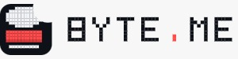</p>

> **How to use this template:** every yellow <mark>✏️</mark> box is yours to fill in. Replace the whole box with your own words. Everything else was taken from the code, so check it if you change the app. When you are done, run `python docs/build.py` to rebuild the PDF, the poster and the slides.

## 1. Project Overview | نظرة عامة على المشروع

| Field | Value |
|-------|-------|
| **Project Title** | BYTE.ME: Food Delivery App |
| **Project Type** | Web application |
| **Description** | <mark>✏️ Student writes: 2–3 sentences. What is BYTE.ME and what can people do with it?</mark> |
| **Target Users** | <mark>✏️ Student writes: who will use it? (customers, restaurant owners, …)</mark> |
| **Live app** | <https://byte-me.streamlit.app/register> |

### Tech Stack | التقنيات المستخدمة

| Category | Technology | Purpose |
|----------|-----------|---------|
| Language | Python | All the app's logic |
| Framework | Streamlit 1.64 | Web pages, forms, the role-based menu and session state |
| Database | SQLite (built into Python) | Users, restaurants, dishes, orders and payments in `database/database.db` |
| Styling | HTML + CSS inside `st.markdown` | The orange banner, cards and dish photos, defined once in `app.py` |
| Images | Web links (Wikimedia Commons, TheMealDB) | Dish photos saved in `products.image_url` |

### Dependencies | المكتبات

| Package | Version | Purpose |
|---------|---------|---------|
| streamlit | 1.64.0 | The whole web interface. It is the only package in `requirements.txt`. |
| sqlite3 | Standard library | Talking to the database. Nothing to install. |
| base64 | Standard library | Turning `images/background.png` into text for the CSS. |

## 2. Problem Statement | المشكلة

<mark>✏️ Student writes: 2–3 sentences. What problem does BYTE.ME solve? Who has this problem?</mark>

### Why does it matter? | لماذا هذا مهم؟

<mark>✏️ Student writes: 2–3 sentences. What happens to people when this problem isn't solved?</mark>

### How is it currently solved? | كيف تُحل المشكلة حاليًا؟

<mark>✏️ Student writes: 2–3 sentences. What do people use today (calling the restaurant, other apps, …), and what is still hard about it?</mark>

## 3. Technical Architecture | البنية التقنية

### Project Structure | هيكل المشروع

```text
adel-byte-me/
├── app.py                     # Runs first every time: look of the app, cart/user defaults, role-based menu
├── app_pages/
│   ├── home.py                # Restaurant list with search and food-type filter
│   ├── menu.py                # One restaurant's dishes, add to cart
│   ├── login.py               # Log in with email and password
│   ├── register.py            # Create a customer account
│   ├── cart.py                # Cart, delivery details, payment, place order
│   ├── orders.py              # The logged-in user's orders
│   ├── add_restaurant.py      # Owner/admin: add a restaurant
│   ├── add_product.py         # Owner/admin: add a dish
│   ├── add_category.py        # Owner/admin: add a category
│   ├── manage_orders.py       # Owner/admin: change each order's status
│   └── logout.py              # Clear the session and go back to Home
├── database/
│   ├── create_tables.sql      # The schema (8 tables)
│   ├── insert_*.SQL           # Demo data, loaded in foreign-key order
│   ├── add_product_photos.SQL # Photo links for the 16 demo dishes
│   └── database.db            # The SQLite database the app uses
├── images/                    # logo.png, favicon.png, background.png
├── docs/                      # This documentation, the poster, the slides and the diagrams
└── requirements.txt           # streamlit==1.64.0
```

### Architecture and Data Flow | تدفق البيانات

```text
User's browser
    -> app.py (runs before every page)
        -> reads st.session_state.user and builds the menu with st.navigation
        -> runs the chosen screen in app_pages/
            -> the screen opens its own sqlite3 connection
            -> plain SQL: SELECT / INSERT / UPDATE
            -> commit and close
```

There is no services layer. Each screen holds its own SQL so it can be read on its own, top to bottom.

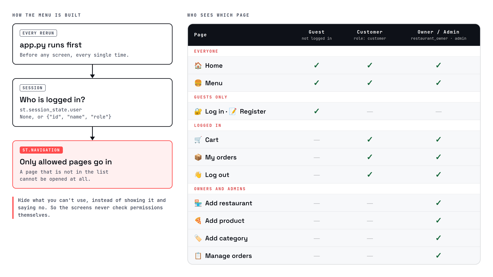

### Key Files | الملفات الأساسية

| File | Purpose |
|------|---------|
| `app.py` | Sets the page title and icon, the logo, the shared CSS and the marble background. Decides which pages go in the menu for guests, customers, and owners/admins. |
| `app_pages/cart.py` | The biggest screen. Shows the cart with ➖ / ➕, takes the delivery details and payment method, checks stock again, and saves the order in five steps. |
| `app_pages/menu.py` | Shows dishes that are available and in stock. Stops the cart from mixing restaurants or going over the stock. |
| `app_pages/manage_orders.py` | Lists every order with its customer, address and payment, and lets an owner or admin change the status. |
| `database/create_tables.sql` | The 8 tables, with `CHECK` rules for statuses, roles and payment methods. |

## 4. Features & User Flow | المميزات ورحلة المستخدم

### Feature List | قائمة المميزات

| # | Feature | Description | Status |
|---|---------|-------------|:------:|
| 1 | Restaurant list | Search by name and filter by food type, three cards per row. | Complete |
| 2 | Menus with photos | Each dish shows a photo, description, rating, calories and price. | Complete |
| 3 | Accounts | Register as a customer and log in with email and password. | Complete. Passwords are plain text (see Limits). |
| 4 | Cart | ➖ / ➕ / 🗑️ for each dish, up to the stock, from one restaurant only. | Complete |
| 5 | Checkout | City, address, phone, delivery notes, and cash, card or mobile wallet. | Complete. No real payments. |
| 6 | My orders | Each order's number, status, total, payment and notes. | Complete |
| 7 | Owner/admin tools | Add restaurants, dishes and categories. | Complete. Owners can edit any restaurant. |
| 8 | Manage orders | Move an order between pending, preparing, completed and canceled. | Complete |

### User Flow | رحلة المستخدم

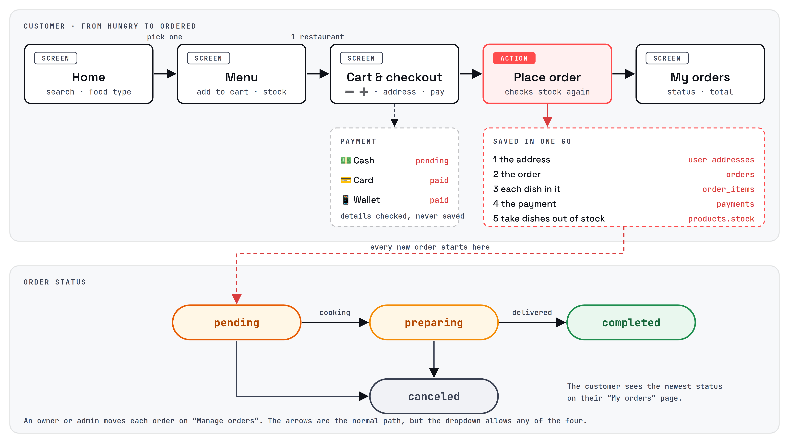

```text
Home (app_pages/home.py)
    -> See menu -> Menu (app_pages/menu.py)
        -> guest: "Log in to order" -> Log in / Register
        -> logged in: Add to cart
            -> Cart (app_pages/cart.py)
                -> delivery details + payment -> Place order
                    -> saves address, order, items, payment; takes dishes out of stock
                    -> My orders (app_pages/orders.py)

Owner / admin:
    Manage orders (app_pages/manage_orders.py) -> pending -> preparing -> completed (or canceled)
    Add restaurant / Add product / Add category
```

### Screen Reference | الشاشات

| Screen | File | Who sees it | Description |
|--------|------|-------------|-------------|
| Home | `app_pages/home.py` | Everyone | Welcome line, search box, food-type dropdown, restaurant cards. |
| Menu | `app_pages/menu.py` | Everyone | The chosen restaurant's dishes. Logged-in users get a quantity box and "Add to cart". |
| Log in | `app_pages/login.py` | Guests | Email and password. |
| Register | `app_pages/register.py` | Guests | Name, phone, age, password, address, date of birth, email. |
| Cart | `app_pages/cart.py` | Logged in | Cart, delivery details, payment method, order summary, "Place order". |
| My orders | `app_pages/orders.py` | Logged in | The user's orders, newest first. |
| Add restaurant / product / category | `app_pages/add_*.py` | Owners, admins | Forms that add a row to the database. |
| Manage orders | `app_pages/manage_orders.py` | Owners, admins | Every order with a status dropdown and "Save". |
| Log out | `app_pages/logout.py` | Logged in | Clears the session and reloads. |

## 5. UI/UX Design | تصميم واجهة المستخدم

### Screenshots | لقطات الشاشة

| Home | Menu |
|------|------|
| 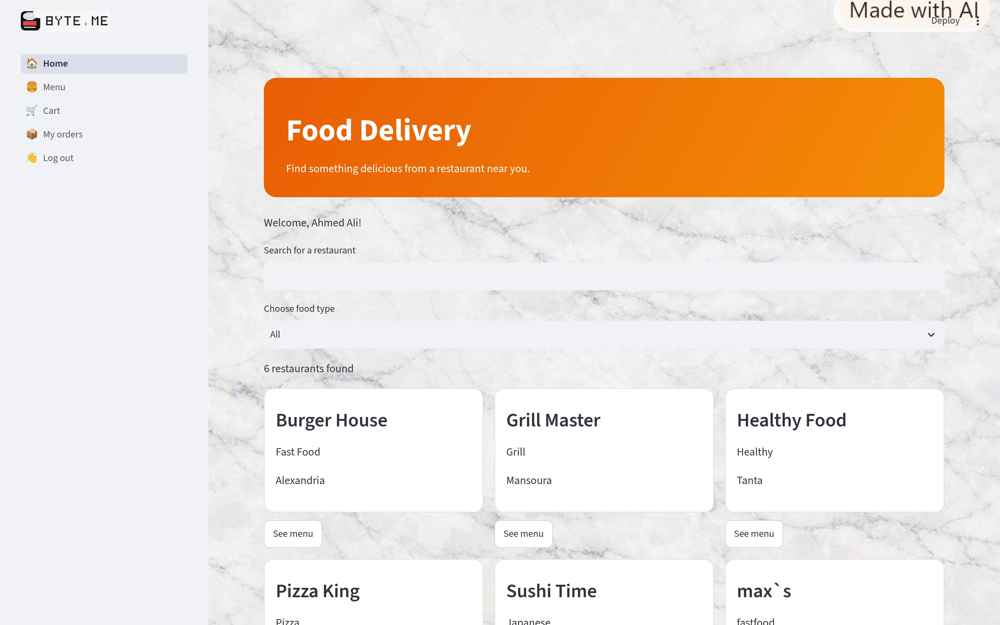 | 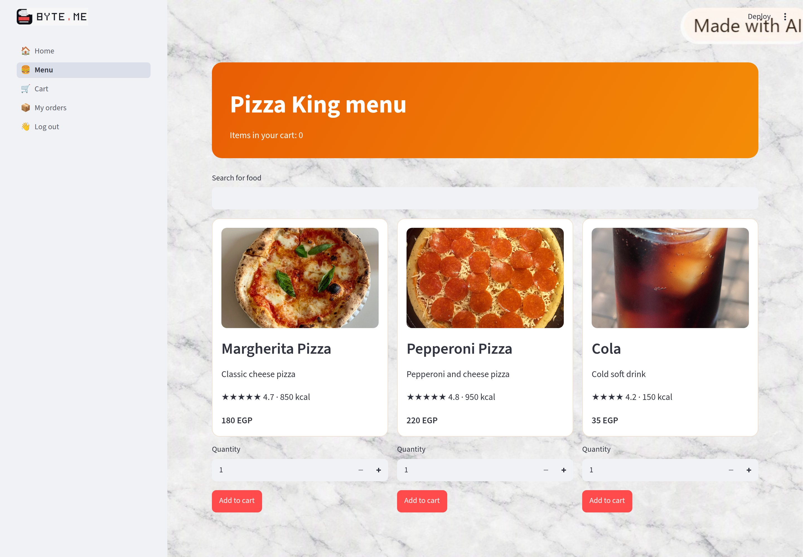 |

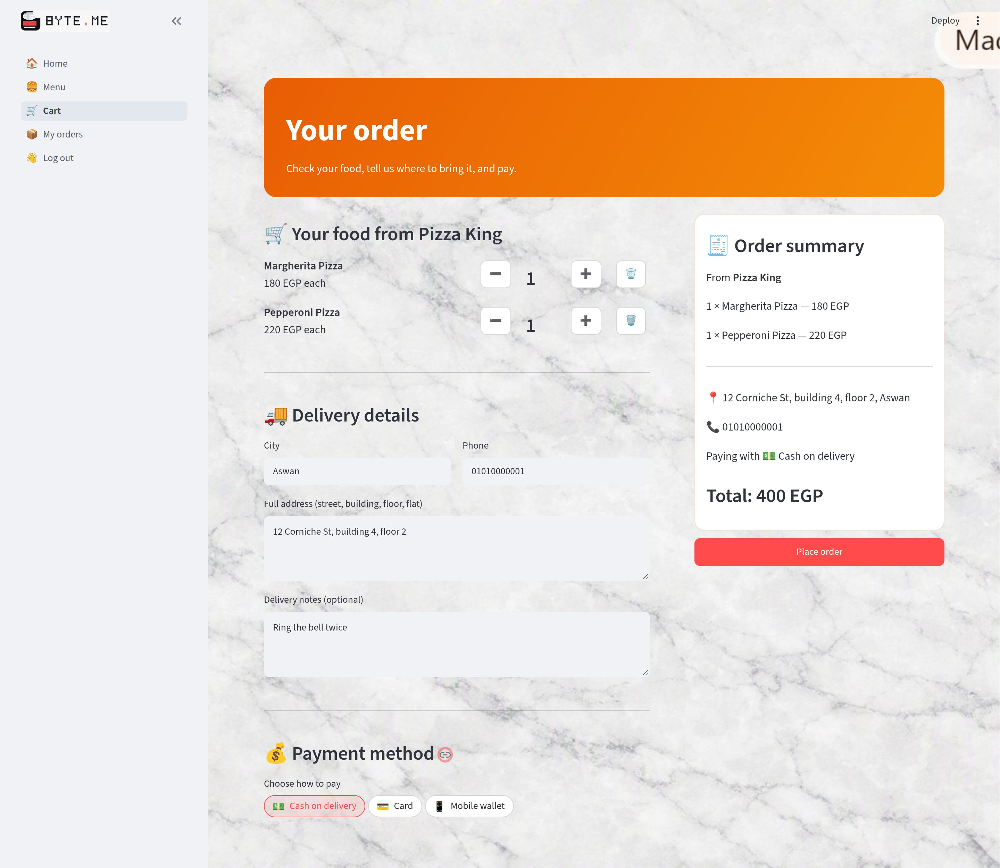

| My orders | Manage orders |
|-----------|---------------|
| 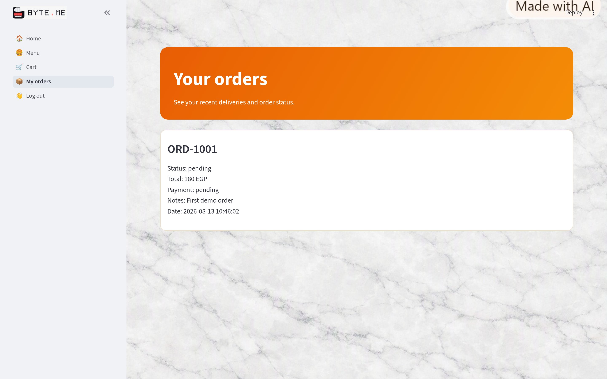 | 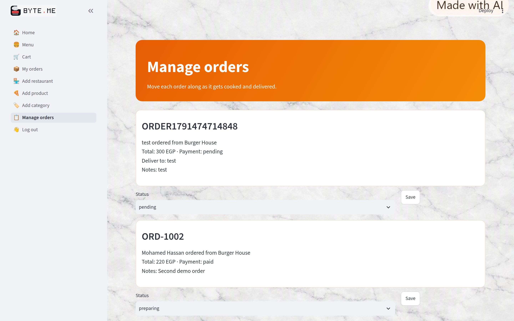 |

| Log in | Register |
|--------|----------|
| 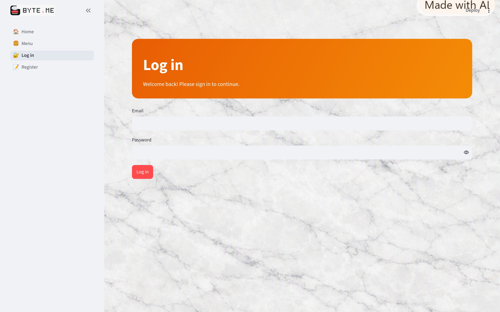 | 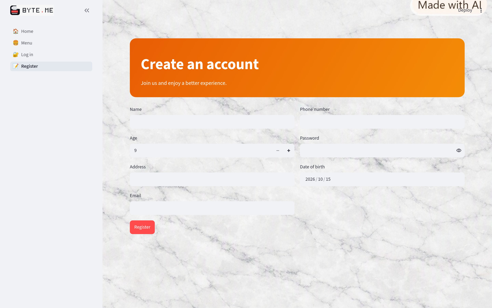 |

Try the app: <https://byte-me.streamlit.app/register>


### Design System | نظام التصميم

| Element | Current implementation |
|---------|------------------------|
| Logo | A pixel-art lunch box with a bite taken out of the corner, next to "BYTE.ME" in pixel letters with a red dot (`images/logo.png`). The mark alone is the browser-tab icon (`images/favicon.png`). |
| Primary color | Orange banner gradient, `#E85D04` → `#F48C06` |
| Accent color | Logo red `#FF4B4C`, also used by Streamlit for primary buttons |
| Ink / background | Logo ink `#0E1118` on a white marble background (`images/background.png`) |
| Cards | White, `1px` border `#F0DFCC`, `14px` rounded corners |
| Dish photos | A `div` with the photo as its background, all `180px` tall so cards line up |
| Font | Streamlit's default font in the app. The poster and slides use Silkscreen (pixel), Space Grotesk and JetBrains Mono. |
| Buttons | One red `type="primary"` button per screen for the main action |
| Layout | Wide pages, three cards per row, a left menu that changes with the user's role |

## 6. Data Sources | مصادر البيانات

### Data Sources | مصادر البيانات

| Source | Type | Description |
|--------|------|-------------|
| Sign-up form | User input | Name, age, address, email, phone, password and date of birth go into `users`. |
| Checkout form | User input | City, address and phone go into `user_addresses`. Delivery notes go into `orders.notes`. Card and wallet details are checked but never saved. |
| Owner/admin forms | User input | New restaurants, dishes and categories. |
| `database/insert_*.SQL` | Demo data | 5 restaurants, 8 categories, 6 dishes, 3 users and 2 orders. The `database.db` in the repo has more, including the 16 dishes that `add_product_photos.SQL` gives photos to. |
| Wikimedia Commons, TheMealDB | Web images | Dish photos, linked by URL in `products.image_url`. |

### Database Schema | قاعدة البيانات

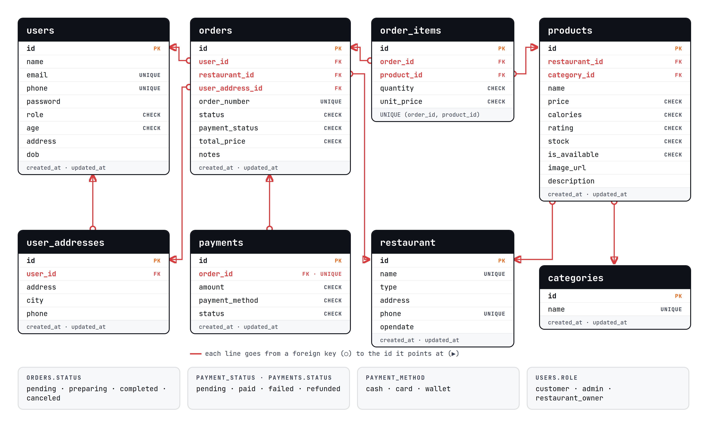

| Table | Columns | Description |
|-------|---------|-------------|
| `users` | `id`, `name`, `age`, `address`, `email`, `phone`, `password`, `role`, `dob` | Accounts. `role` is customer, admin or restaurant_owner. |
| `restaurant` | `id`, `name`, `opendate`, `address`, `type`, `phone` | Restaurants. `type` is the food type used by the Home filter. |
| `categories` | `id`, `name` | Dish categories. |
| `products` | `id`, `restaurant_id`, `category_id`, `name`, `calories`, `price`, `rating`, `description`, `image_url`, `stock`, `is_available` | Dishes. |
| `user_addresses` | `id`, `user_id`, `address`, `city`, `phone` | One new row for each order's delivery address. |
| `orders` | `id`, `user_id`, `restaurant_id`, `user_address_id`, `order_number`, `status`, `notes`, `total_price`, `payment_status` | Orders. `order_number` comes from the time in milliseconds. |
| `order_items` | `id`, `order_id`, `product_id`, `quantity`, `unit_price` | The dishes in each order. |
| `payments` | `id`, `order_id`, `amount`, `payment_method`, `status` | One payment per order: cash, card or wallet. |

Every table except `order_items` also has `created_at` and `updated_at`. `order_items` only has `created_at`.

### External APIs | الخدمات الخارجية

| API | Purpose | Rate Limit |
|-----|---------|------------|
| None | The app calls no outside API. Dish photos are plain image links that the browser loads. | Not applicable |

### Limits | حدود المشروع

These shortcuts were taken on purpose to keep the code simple. The full list is in the README.

- Passwords are saved as plain text.
- Roles are set by hand in the database. Everyone who signs up is a customer.
- Restaurant owners can do everything admins can, for every restaurant.
- There are no real payments. Card and wallet orders are marked "paid" at once, and cash stays "pending".
- Reloading the page logs you out and empties the cart.
- Orders and sign-ups on the live app are lost when it restarts or is redeployed.

## 7. Educational Content | المحتوى التعليمي

### Learning Objectives | أهداف التعلم

Through building this project, a student can practice:

1. <mark>✏️ Student writes: something you learned about building web pages with Streamlit</mark>
2. <mark>✏️ Student writes: something you learned about databases and SQL</mark>
3. <mark>✏️ Student writes: something you learned about logins and who can see which page</mark>
4. <mark>✏️ Student writes: something you learned about checking what people type into forms</mark>
5. <mark>✏️ Student writes: one more thing you learned</mark>

### Cultural / Historical Context | السياق الثقافي

| Topic | Description |
|-------|-------------|
| <mark>✏️ Student writes: topic, e.g. food delivery in Egypt</mark> | <mark>✏️ Student writes: 1–2 sentences</mark> |
| <mark>✏️ Student writes: topic, e.g. Egyptian food</mark> | <mark>✏️ Student writes: 1–2 sentences</mark> |
| <mark>✏️ Student writes: topic, e.g. paying online safely</mark> | <mark>✏️ Student writes: 1–2 sentences</mark> |

### Curriculum Alignment | الارتباط بالمنهج

| Skill Area | What the Student Practices |
|------------|---------------------------|
| Problem Solving | <mark>✏️ Student writes: 1 sentence</mark> |
| Computational Thinking | <mark>✏️ Student writes: 1 sentence</mark> |
| Creativity | <mark>✏️ Student writes: 1 sentence</mark> |
| Collaboration | <mark>✏️ Student writes: 1 sentence, or "built alone"</mark> |
| Technical Writing | <mark>✏️ Student writes: 1 sentence</mark> |

## 8. Marketing Plan | خطة تسويقية

### Target Audience | الجمهور المستهدف

- **Primary:** <mark>✏️ Student writes: the main group of people</mark>
- **Secondary:** <mark>✏️ Student writes: a second group</mark>

### Platforms | المنصات

- <mark>✏️ Student writes: where people will use it, e.g. phone and desktop browsers</mark>
- <mark>✏️ Student writes: where you will show it or share it</mark>

## 9. Student Worksheet | ورقة عمل الطالب

### My Project Information | معلومات مشروعي

**Student Name:** <mark>✏️ Student writes: your full name</mark>  
**Project Title:** BYTE.ME: Food Delivery App

### What is your project about? | عن ماذا يتحدث مشروعك؟

<mark>✏️ Student writes: 1–2 sentences in your own words</mark>

### What problem does it solve? | ما المشكلة التي يحلها؟

<mark>✏️ Student writes: 1–2 sentences in your own words</mark>

### My Data | بياناتي

**Where does data come from?**

<mark>✏️ Student writes: who types it in, and what came with the demo files?</mark>

**What data is stored?**

<mark>✏️ Student writes: which tables, and what is kept in them?</mark>

### What I Learned | ماذا تعلمت

1. **The hardest part:** <mark>✏️ Student writes</mark>
2. **The most fun part:** <mark>✏️ Student writes</mark>
3. **If I had more time:** <mark>✏️ Student writes</mark>
4. **One thing I would do differently:** <mark>✏️ Student writes</mark>

### Screenshot of My Project | لقطة من مشروعي


---

<mark>✏️ Student writes: team or school name · event · year</mark>
